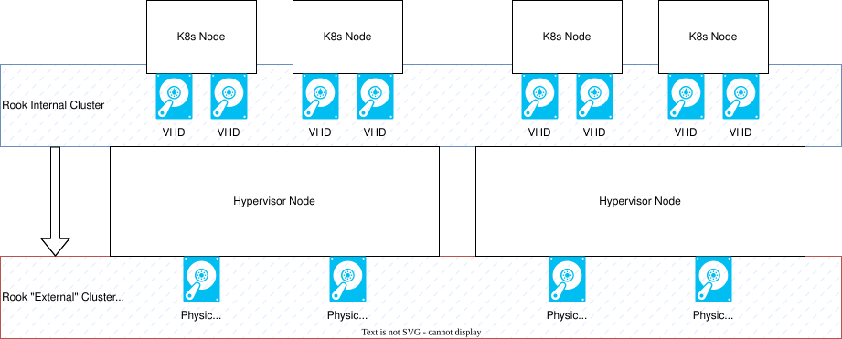

# Right, what's all this then?
This is an enormous toolkit I built to help me build and maintain Kubernetes clusters. Make sure to read each step before running the code!

# Overview
This kit has 3 main functions:
* Build underlying infrastructure for running K8s (management, VMs, network)
* Structure tools you will _likely_ need, and put them in a common location to get ahead of sprawl
* Build a Kubernetes cluster

## Folder Structure
### `./archive`
Old snippets that are referenced from time-to-time, but not actively maintained/do nothing.

### `./oobe`
These are Ansible playbooks to either build or update a kubernetes cluster. They are run from the management machine against the worker nodes. All commands in this document expected to be run from the `/automation/kubernetes/` folder, and find these files in `/automation/kubernetes/oobe`.

`provision_k8s_node-containerd.yaml` for "docker" runtime

`provision_k8s_node-cri-o.yaml` for "podman" runtime

#### `./oobe/templates`
These are config files the Ansible playbooks need to reference/provision during their work. They generally don't need touching.

`calico.conf` configures host networking to ignore calico-managed NICs

`containered_config_default.conf` when Docker installs containered, it changes some settings to optimize containerd for Docker. Put it back.

`module_kubernetes.conf` loads the kubernetes networking requirements at system boot (`br_netfilter` into `modules-load.d`)

`sysctl.conf` enables `net.ipv4.ip_forward=1` by replacing `/etc/sysctl.conf`. This *really* expects a freshly provisioned VM.

### `./rook`
Contains elements for provisioning Cluster storage using the Rook operator.

## Steps Overview
This guide picks up after [configuring your management machine](#management-machine)

1. [Provision VMs in Proxmox](https://github.com/benjaminpieplow/automation/wiki/New-K8s-Node-Cluster#provision-vms-in-proxmox)
2. [Configure VMs for Kubernetes](https://github.com/benjaminpieplow/automation/wiki/New-K8s-Node-Cluster#configure-vms-for-kubernetes)
3. [Create a cluster](https://github.com/benjaminpieplow/automation/wiki/New-K8s-Node-Cluster#create-a-cluster)
4. [Try again](https://github.com/benjaminpieplow/automation/wiki/New-K8s-Node-Cluster#screwed-up)

## Quality of Life fixes
These are things you should build into your workflow, either using your `.bashrc`, aliases, or memorization.

**Save your inventory in a variable** to avoid having to type the full path into each `ansible` command.
```
inventoryDir="~/common/inventory.yaml"
```

**Set the location of your current kubernetes config file** to avoid having to specify it in every `kubectl` command. Where `CLUSTERNAME` is something that uniquely identifies your cluster.
```
export KUBECONFIG=$HOME/.kube/config-CLUSTERNAME
```

Hint: `kubectl` looks for `$HOME/.kube/config`, if it does not find this, it tries the localhost. If you have a dedicated management machine (not running a cluster), and don't create a `.kube/config`, you can effectively add a check to make sure you're running in the right cluster by hard-coding your dev cluster into your `.bashrc`, reducing the risk of accidentally blasting something into production, taking down the entire client app and leading to an awkward call between them, your boss, and his boss.

**Create a folder for your Git repos** so as to keep non-git code separate from version-controlled code. I have this repo in `~/source/automation`; I *strongly* suggest keeping your code structured this way. If you have a different folder for your git codes, you will need to update it yourself, AFAIK this is not hard-coded in any scripts, but all commands (in this document) are written to expect it.
```
mkdir ~/source
cd ~/source
git clone ...
```

# Provision VMs in Proxmox
This is where the real meat-and-potatoes begins; this is the first step required for every K8s cluster you build. This will create VMs in Proxmox, ready to be remotely administered using a pre-specified key. The playbook reboots the VM, so if your router (say OPNsense) is configured to register DHCP hostnames in DNS, you can fire this, get a coffee, and SSH into the machine.

Ultimately, all this does is create an Ubuntu Server VM and install a root SSH key; you can do the same "your way", just make sure you can run the test at the end, and you account for configuration drift.

## Prerequisites
On your management machine, you will need,

* [Ansible installed](https://github.com/benjaminpieplow/automation/blob/main/bash/scripts/ansible_install.sh)
* `~/common/auth/proxmox` has valid [proxmox.yaml](https://github.com/benjaminpieplow/automation/blob/main/common/auth/proxmox.yaml)
* `~/common/inventory.yaml` has valid [inventory.yaml](https://github.com/benjaminpieplow/automation/blob/main/common/inventory.yaml) (hint: replace proxbar)


You can test this with,

```
ansible-playbook -vvvv --inventory $inventoryDir ~/source/automation/ansible/playbooks/proxmox/test_proxmox.yaml -e "proxmox_node_name=cluster_foo"
```

Where `cluster_foo` is the name of your Proxmox node in `~/common/auth/proxmox.yaml`. The output will include some JSON containing,
```
ok: [localhost] => {
    "changed": false,
    "invocation": {
        "module_args": {
            "api_host": "proxbar.bar.com",
            <other stuff>
        }
    },
    "proxmox_nodes": [
        {
            "status": "online",
            "type": "node",
            <other stuff>
        }
    ]
}
```

## Steps
### Create a template
Script: **Line by line** run [jammy-template-9000.sh](https://github.com/benjaminpieplow/automation/blob/main/bash/scripts/jammy-template-9000.sh) on a proxmox node. I will automate this *eventually*.

### Create a VM
Note: Currently, this runs in Ansible; I will be switching to the CLI, as the VM-Create from Template is difficult to modularize, and extremely buggy.

Run the following ansible-playbook. Notes,

* You will be prompted for required info
* It takes 5+ minutes, as Ansible pushes through some restarts
* These can be run in parallel (use screen or multiple SSH windows) up to the capacity of your hypervisor. If you do too many at once, the reboot times out and you will have a bad day (nuke the VM and try again).

```
ansible-playbook -vvvv --inventory $inventoryDir ~/source/automation/ansible/playbooks/proxmox/new-US-2204-k8s.yaml
```

-- OR -- with all variables,

```
inventoryDir="~/common/inventory.yaml"
ansible-playbook --inventory $inventoryDir ~/source/automation/ansible/playbooks/proxmox/new-US-2204-k8s.yaml \
-e "vm_ram_max=8192 vm_ram_startup=2048 proxmox_node_name=node-foo vm_nic0_vlan=1 vm_name=vm-bar new_vm_id=123"
```

Where,

* `vm_ram_max` is max ballooning RAM
* `vm_ram_startup` is RAM at startup
* `vm_name` is hostname of the VM (also used in Proxmox)
* `new_vm_id` is the ID the VM will get in Proxmox
* `proxmox_node_name` is the name of your Proxmox node in `~/common/auth/proxmox.yaml`
* `vm_nic0_vlan` is the ID of the VLAN the VM's primary NIC will be tagged with (currently broken; uses VLAN ID from template)

You may also want to edit the `scsi` block in the template. I have two VM "data disks" deploying to `local-lvm`; prameterizing this is nearly impossible, especially when accounting for different infrastructures. My Rook implementation expects,

* two disks in the VM which it will fully consume
* at least 3 worker VMs
* worker VM to hypervisor node affinity

They can also be left as-is on `local-lvm`, and moved onto dedicated storage manually once you buy some 🙃

### Test connection to VM
To skip mucking around with passwords, I don't set one, which means Ubuntu won't let you log into the machine. To get around this, check DHCP for IPs and SSH in using,
```
ssh root@10.0.0.1 -o StrictHostKeyChecking=accept-new -i ~/.kube/id_mgmt_ed25519
```

This also auto-accepts SSH keys, so ansible doesn't have a cow.


# Configure VMs for Kubernetes
This uses a Playbook to bring VMs into a ready-to-join state. It expects the VM was built on the Ubuntu Jammy templates created above.

## Prerequisites
This assumes you are working from a management machine that is *not* going to be part of the cluster. It requires,

* [Ansible installed](https://github.com/benjaminpieplow/automation/blob/main/bash/scripts/ansible_install.sh)
* `~/common/inventory.yaml` has valid [inventory.yaml](https://github.com/benjaminpieplow/automation/blob/main/common/inventory.yaml) (hint: fill in k8s)
* nodes reachable via SSH

You can test this with,

```
ansible-playbook -vvvv --inventory $inventoryDir --limit k8s ~/source/automation/ansible/playbooks/test_host.yaml
```

The output will include some JSON and end with,
```
PLAY RECAP **********
<host1>        : ok=2
<host2>        : ok=2
<host3>        : ok=2
...
```

Probably. Troubleshoot as necessary.

## Steps
This has been consolidated into a single playbook. Either this works, or your day gets long.

`cri-o` "Podman" runtime (recommended):
```
ansible-playbook --inventory $inventoryDir --limit k8s --tags "oobe" ~/source/automation/kubernetes/oobe/provision_k8s_node-cri-o.yaml
```

`containerd` "Docker" runtime:
```
ansible-playbook --inventory $inventoryDir --limit k8s --tags "oobe" ~/source/automation/kubernetes/oobe/provision_k8s_node-containerd.yaml
```

# Create a Cluster
A Kubernetes cluster is administered from a cluster member often called a Master Node. This step configures this node, it therefore must be done before joining nodes to the cluster. Do this if building a new cluster.

## Prerequisites
This assumes you are working from a management machine that is *not* going to be part of the cluster. It requires,
* [kubectl installed](#prepare-the-management-machine)
* node configured using `provision_k8s_node-CCC.yaml`

This also assumes a good deal of "you know what you are doing". Generic, I know; here are some lessons I learned the hard way.

* DNS can be used to address nodes in *most* scenarios; for cluster administration, making that IP static can save you a respectable amount of ouch.
* You need to know how [cluster networking](https://kubernetes.io/docs/concepts/cluster-administration/networking/) works, why you need Calico *and* NGINX, and why you will never (want to) reach the `--pod-network-cidr` range from your routed network. You will need this range defined; If using a SARCASM-compliant network plan, 192.168.0.0/16 can be used for this purpose.

## Steps

1. SSH to the node you want as master
```
ssh -i ~/.kube/id_mgmt_ed25519 root@$MASTER_NODE
```

2. Create the cluster
```
kubeadm init --apiserver-advertise-address=$MASTER_NODE_IP --pod-network-cidr=192.168.0.0/16
```

This command outputs a very handy `kubectl join` command, which I suggest saving in your `~/.kube` folder. Forgot to save it? Get a fresh join command with

```
kubeadm token create --print-join-command
```

Run it remotely with
```
ssh root@$WORKERNODE_IP '<output_from_token_create>'
```

## Grab the cluster's administration/connection info
Note: copy this into whatever host you use to administer the cluster. Run this from your management machine, changing the `-CLUSTER` to a name uniquely identifying the cluster or removing it entirely.

```
mkdir -p $HOME/.kube
scp -i ~/.kube/id_mgmt_ed25519 root@$MASTER_NODE_IP:/etc/kubernetes/admin.conf ~/.kube/config
#sudo chown $(id -u):$(id -g) $HOME/.kube/config-CLUSTER
```


`kubectl` will now connect to the newly created cluster (optionally, with `--kubeconfig ~/.kube/config-CLUSTER`), you can test it with `kubectl get nodes` (to install kubectl, see below)

The rest of the guide is run from the management machine, it's convenient to set
```
export KUBECONFIG=$HOME/.kube/config-CLUSTER
```

## Join worker nodes to cluster
Run the `kubeadm join` command on each worker node.

## Configure cluster networking
Straight from [Install Calico](https://docs.tigera.io/calico/latest/getting-started/kubernetes/self-managed-onprem/onpremises#install-calico).

On your management machine, run

```
kubectl create -f https://raw.githubusercontent.com/projectcalico/calico/v3.29.1/manifests/tigera-operator.yaml
```

Next, download a file you _think_ you will customize, until you realize it is way above your paygrade and fire the stock config at your cluster.
```
mkdir ~/k8s-admin
cd ~/k8s-admin
curl https://raw.githubusercontent.com/projectcalico/calico/v3.29.1/manifests/custom-resources.yaml -O
# nano custom-resources.yaml
kubectl create -f custom-resources.yaml
```

Before moving on to the next step, a prayer or drink is _strongly_ suggested.

```
watch kubectl get pods -n calico-system
```

You should see a result similar to the below.
```
NAMESPACE     NAME                READY   STATUS                  RESTARTS         AGE
kube-system   calico-node-txngh   1/1     Running                   0              54s
```

## Configure ingress (NGINX)

### Aside: Why _two_ NGINXs?
So... I wanted this to be a technical guide, not a theory/course, but given how long it took me to figure it out, I'm including it here. Skip the Aside for the steps to deploy.

As far as I can tell, [via](https://bentoluiz.dev/self-hosting/linux/ubuntu/kubernetes/2023/06/22/selfhosting-5-loadbalancer/), there are two deployments of NGINX that make this setup highly available.

- Entrypoint/Edge _load balancer_
- Cluster _ingress controller_

The problem this has to solve is, when you (from the outside) ask for `https://example.com/foo`, your client has no idea what pod will resolve this request, it simply does an `nslookup` for `example.com` and chucks the request at the IP address returned by DNS. To solve that problem, a system must be aware of which pod(s) are currently available to give you `/foo`, so you don't get the pod running `/bar`. This is done by the _ingress controller_, it routes traffic delivered to the cluster around, to the pod that's currently in the mood to talk to you. The second problem you have is, how do you find that ingress service? Via DNS, duh, but even if you have your cluster nodes exposed to the internet (don't), how do you make sure you give the client an IP of a node that currently exists/functions? Hope? No, that problem is solved by a _load balancer_ which can be deployed to be highly available and serve multiple clusters/services, for example, using a dedicated hardware-accelerated F5 load balancer, or the NGINX service built into your router (because you're too poor to even get a _quote_ for an F5 BIG-IP). The _load balancer_ abstracts requests from the _node_ answering their query, and the _ingress controller_ abstracts requests from the _pod_ answering their query.

To make this work, the NGINX _ingress controller_ runs an instance (a pod) on each node, exposing itself on the node's IP using a "node port", a not-443 port (eg. 30535). This listens for HTTP requests destined for the cluster. The "upstream" NGINX _load balancer_ instance (F5/router) is aware of the nodes and continuously monitors their availability.

For an example, assume a 3-node cluster. Only Node3 can be reached by the load balancer, only Node2 has an App pod, and only Node1 has a functional ingress controller. Will the admin be fired? When a request comes in, it takes the following path:


- (Green) Client -> Load Balancer:443
  - Load balancer unwraps TLS
  - Load balancer determines only Node3's HTTP service is available
  - Load balancer forwards request to Node3:30535
- (Orange) Load Balancer -> Node3
  - Node3's NodePort service determines the request must go to NGINX Ingress Controller
  - (Yellow) Node3 forwards the request to Node1's NGINX
- (Red) Node1/Ingress Controller -> APP:8443
  - Ingress controller determines request must go to App
  - Ingress controller knows only Node2 has an available App instance
  - Ingress Controller forwards request to Node2
- App processes the request, and it flows "back" to the client. The admin keeps their job.

This second communication happens over the "cluster network", that's what we need Calico for. This guide has you deploy IP-in-IP (default), but you can wrap this with encryption if moving over insecure networks, negating the need to give each App a certificate. Effectively, this networking plugin ensures that as long as a node is healthy, pods are given IP addresses reachable by the ingress controller, regardless of which node(s) either is running on. The [official documentation](https://kubernetes.github.io/ingress-nginx/deploy/baremetal/#over-a-nodeport-service) suggests using MetalLB, but also says it's in Beta, and I don't know MetalLB so... Here we are.

You can read about other NGINX solutions [here](https://kubernetes.github.io/ingress-nginx/deploy/baremetal/).

## Deploy NGINX Ingress Controller
By default, the helm chart will install NGINX in a mode where it randomly selects a nodeport from a range (30000 - 32767). This does not help us, because our upstream load balancer/proxy will not run `kubectl -n ingress-nginx get svc` to figure out where it can find the service. Instead, we have to bind NGINX to a specific nodeport. To do this, we'll edit the helm chart for the baremetal deployment.

Download the raw configuration.
```
mkdir nginx
cd nginx
helm show values ingress-nginx --repo https://kubernetes.github.io/ingress-nginx >> nginx_config.yaml
```

Edit the `controller: service: nodePorts:` section with your choice of ports (I am using 31080 and 31443 to avoid collisions). See example `nginx_config.yaml`, or:
```
    nodePorts:
      # -- Node port allocated for the external HTTP listener. If left empty, the service controller allocates one from the configured node port range.
      http: 31080
      # -- Node port allocated for the external HTTPS listener. If left empty, the service controller allocates one from the configured node port range.
      https: 31443
```

This is all the configuration I needed to do; I have added the file to the repo with these customized values, but highly suggest pulling/configuring a fresh one. This will also update the `tag` to the latest version, as well as pulling along any new configs needed to get it working.

You can test your configuration with:
```
helm upgrade --install ingress-nginx ingress-nginx \
  --repo https://kubernetes.github.io/ingress-nginx \
  -f ./nginx_config.yaml \
  --namespace ingress-nginx --create-namespace \
  --dry-run >> plan.yaml
```

Once that looks good, cross your fingers and _fire_.
```
helm upgrade --install ingress-nginx ingress-nginx \
  --repo https://kubernetes.github.io/ingress-nginx \
  -f ./nginx_config.yaml \
  --namespace ingress-nginx --create-namespace
```

Check your deployment with,
```
$ helm list -A
NAME            NAMESPACE       REVISION        UPDATED                                 STATUS          CHART                   APP VERSION
ingress-nginx   ingress-nginx   3               2024-12-10 20:07:22.509610325 +0000 UTC deployed        ingress-nginx-4.11.3    1.11.3     

$ kubectl get pods -n ingress-nginx
NAME                                       READY   STATUS    RESTARTS       AGE
ingress-nginx-controller-cbcf8bf58-s9klv   1/1     Running   6 (5m7s ago)   8m15s
```

### Configure downstream load balancer (NGINX on OPNsense)
This section is very specific to my homelab, but chances are the steps will be the same if you use your own upstream, so it might help.

For each worker node,

- Create an Upstream Server
  - Description: Something useful
  - Server: FQDN of the node (IP should work, haven't tested it though)
  - Port: Port set above (`31443` recommended)

When creating upstream servers:

- If using port `31443`, make sure to either uncheck "TLS: Verify Certificate", or ensure NGINX trusts the server certificates

## Cluster storage
Recommended reading: [Persistent Volumes](https://kubernetes.io/docs/concepts/storage/persistent-volumes/#access-modes) and [Storage Classes](https://kubernetes.io/docs/concepts/storage/storage-classes). ~~Through some dark magic, NFS seems to punch in the same weight-class as AzureFile and CephFS, so I will use that.~~ That statement is true until you (try to ) run a database on NFS storage. At this point, the database will die, you will lose some hours, and configure something else; to prevent those grey hairs preemptively, I will provide guidance on how to configure both, and advise when to use each:
- Rook: Everything possible
- NFS: Direct file read/writes from a NAS file share, which is used by other devices on the network

For both of these, we will use Storage Classes, so applications can choose their storage tier as required. The application (in its manifest) will use these classes to create Persistent Volumes (PVs) based on Persistent Volume Claims (PVCs) based on the correct storage; this will abstract storage management "for the most part" and allow applications to just "ask for" storage. The tags I use are,
- `rook-default` -> OOBE CEPH Storage built on the cluster
- `rook-client-*` -> External CEPH cluster
- `nfs-client-*` -> External NFS server/share

### Rook cluster storage (Theory)
Rook is an operator which manages exposing Ceph to Kubernetes. Much like NGINX, I will briefly explain the theory and key topics.

#### Ceph
Ceph "solves" the problem of having a single point of failure in a cluster; it serves hyper-scalable, highly durable storage. Ceph can be installed on dedicated nodes or in a hyperconverged configuration (see **Storage Design** below). I've outlined the key concepts based on [Ceph documentation](https://docs.ceph.com/en/reef/start/),

- Object Storage Daemons -> **OSD**s attaches to storage and manages read/write, balancing, replication, recovery.
- Ceph Monitor -> Creates maps of the cluster, including CRUSH, OSDs, MDS
- Ceph Manager -> Exposes the Dashboard/API, monitors cluster state, storage
- Ceph Metadata Server -> **MDS** stores Metadata for CephFS
- Ceph File System -> **CepfFS** is a POSIX-compliant file system built on RADOS
- RADOS _Gateway_ -> **RGW** is an Object Gateway. RESTful, supports S3 or Swift
- Ceph Block Device -> **RADOS Block Device** 
- Reliable Autonomic Distributed Object Store -> **RADOS** is the object store at the core of Ceph

Although not built for Kubernetes, this integrates very well with the topology K8s uses; node affinity, horizontal scalability, no single-point-of-failure (besides the operator).

#### Storage Design
**Storage Design** must be considered before deploying. How your disks are going to be exposed to the pods is assisted by, but not determined by, Rook

Rook is designed to work with Kubernetes in a node-level hyper-converged setup, but also supports [External Ceph Clusters](https://github.com/rook/rook/blob/master/design/ceph/ceph-external-cluster.md), which may be useful if you have a hyper-converged Proxmox cluster. The following diagram explains how these work together:



The Rook Internal Cluster deployment expects disks mounted to the Nodes, I use the term "node-level hyper-converged" to describe this infrastructure as the node becomes an atomic fault/scale unit. This is the easiest to set up, and the most practical solution if your kubernetes cluster runs bare-metal. However, it will be less performant and more complex if your Kubernetes nodes are virtualized, as you will need to either pass-through storage or "pay" for the processing overhead of virtualized disks. In this case, it would be more practical to use an External Cluster (hyper-converged virtualized or classic Compute - Network - Storage infrastructure) mounted by Rook.

#### Storage Classes
When workloads need storage, they create a Persistent Volume to store their data. The pods then use a Persistent Volume Claim to "attach" to the PV. A Persistent Volume uses a specific _class_ of storage; this allows workloads to optimize what kind of storage they need. I recommend planning out your storage infrastructure, and creating a naming convention 

### Rook cluster storage (Implementation)

One thing to note; in this section, I deploy the **Rook Operator** with **Helm**, but the **Ceph Clusters** and **Storage Classes** are deployed with standard Kubernetes Manifests. I did not customize much on the Rook Operator, it seems to work well out-of-the-box. The Cluster on the other hand (especially the storage classes) benefit from the additional control offered by using manifests. If you wish to deploy the "bone-stock" variant, use the [Ceph Cluster Chart](https://rook.io/docs/rook/v1.12/Helm-Charts/ceph-cluster-chart/#release).

#### Rook Prerequisites (Required)
According to [Rook documentation](https://rook.io/docs/rook/v1.12/Getting-Started/Prerequisites/prerequisites/), the only node-level requirement is `lvm2`. This is packaged into the Ubuntu nodes built using this guide.

The cluster requires the Ceph Operator Helm Chart. I _strongly_ suggest reading through the [official documentation](https://rook.io/docs/rook/v1.12/Helm-Charts/operator-chart/) if you are new to Ceph/Rook.

Add the helm repo
```
helm repo add rook-release https://charts.rook.io/release
```

Generate an editable file.
```
mkdir ~/k8s-admin/rook
cd ~/k8s-admin/rook
helm show values rook-ceph --repo https://charts.rook.io/release >> rook_config.yaml
```

Changes I recommend:

- I would pin a version, and do updates manually (forget about them until they cause an incompatibility and you _have_ to update)

This list will be updated as I find rough edges.

Deploy the operator with,
```
helm upgrade --install --create-namespace --namespace rook-ceph rook-ceph rook-release/rook-ceph -f rook_config.yaml
```

#### Rook Internal CEPH Cluster (Optional)
Start with customizing the "prod" cluster yaml,

```
curl https://github.com/rook/rook/blob/release-1.18/deploy/examples/cluster.yaml >> cluster.yaml
```

Changes I made,

- pinned version to v19

I'm sure more will reveal themselves once I get to making errors. Deploy the cluster with,
```
kubectl create -f cluster.yaml
```

#### Rook External Cluster

Ha hA! I will write this once I get some more hypervisors; at the time of writing the AI industry ruined the RAM market so nodes are not on the horizon.

#### CEPH dashboard (Optional)
To administer Ceph, a dashboard is _highly_ recommended. This setup supports two methods: **Ingress** and **Node Port**. Ingress has the advantage of integrating with the rest of your HTTP/S infrastructure, Node Port has the advantage of not needing any HTTP/S infrastructure.

My architecture expects HTTP apps, and handles certs with NGINX instances, so I modified `cluster.yaml` to present the dashboard over HTTP. This is not required if you have downstream NGINX instances configured not to verify certs (or you pull this cert and shove it into your trusted certs).
```
  dashboard:
    enabled: true
    port: 8080
    ssl: false
```

**Node Port** (31222):
```
kubectl create -f ./kubernetes/rook/cluster/ceph-dashboard-nodeport.yaml
```

**Ingress**:
```
missing
```

Get password (username `admin`) using:
```
kubectl -n rook-ceph get secret rook-ceph-dashboard-password -o jsonpath="{['data']['password']}" | base64 --decode && echo
```

#### Rook Storage Class
This step requires _either_ the **Internal** or **External** Cluster to be added.


### NFS Cluster Storage (Attached)
Hey, future Ben! Check this output from installing Rook!

> The CSI operator will manage the CSI driver lifecycle for RBD, CephFS, and NFS drivers.

You should _probably_ rewrite this section 🙃

As Kubernetes [does not maintain](https://kubernetes.io/docs/concepts/storage/storage-classes/#provisioner) an NFS "Internal Provisioner", an external one must be used and according to [stackoverflow](https://stackoverflow.com/questions/43295344/kubernetes-dynamic-persistent-volume-provisioning-using-nfs), [subdir](https://github.com/kubernetes-sigs/nfs-subdir-external-provisioner) seems to be the way to go. 

This guide expects that you have an NFS share already, which,

- can be accessed from all of your nodes
- the cluster has read-write permissions to
- allows non-root users to mount (or, [read](https://stackoverflow.com/questions/34113569/kubernetes-nfs-volume-mount-fail-with-exit-status-32))
- `nfs-common` installed on nodes (done if using the node prep playbook)
- (_strongly_ recommend) configuring IP range restrictions on the NFS share, as NFS uses client-side verification

For permissions, I have had the most luck with creating a service user on the NAS (eg. `nfsdataowner`), assigning user `chown nfsdataowner:nfsdataowner`, `chmod 770` permissions to the share (dataset), then setting Mapall User to `nfsdataowner`.

You can test/troubleblast your configuration by running `watch showmount -e FILE_SERVER` from a node. Expected output (note this does not test permissions):
```
Export list for FILE_SERVER:
/mnt/tank/dataset/share k8s01,k8s02,k8s03
```

Once that share is available, we can configure the Provisioner. This will be done via the [NFS Subdirectory External Provisioner Helm Chart](https://github.com/kubernetes-sigs/nfs-subdir-external-provisioner). On the management machine, run:
```
helm repo add nfs-subdir-external-provisioner https://kubernetes-sigs.github.io/nfs-subdir-external-provisioner/
helm upgrade --install nfs-subdir-external-provisioner nfs-subdir-external-provisioner/nfs-subdir-external-provisioner \
    --set nfs.server=x.x.x.x \
    --set nfs.path=/exported/path \
    --set nfs.mountOptions='all_squash,anonuid=1001,anongid=1001' \
    --set storageClass.defaultClass=true
```
Where, [values](https://github.com/kubernetes-sigs/nfs-subdir-external-provisioner/blob/master/charts/nfs-subdir-external-provisioner/README.md):
- `nfs.server=x.x.x.x` is the IP or FQDN of your NFS server
- `nfs.path=/exported/path` is the path of the NFS share (seen in `showmount`)
- `storageClass.defaultClass=true` sets as the default storage class, so it is used by those pesky charts that don't expose storage class
- `nfs.mountOptions='{all_squash,anonuid=1001,anongid=1001}'` are NFS mount options
  - `all_squash` overrides all IDs to anonymous user
  - `anonuid=1001` locks the anonymous user ID to 1001. Sync this to your service account (created above) to basically 
- `storageClass.name=nfs-client` sets the name of the class (if creating multiple storage tiers)

Your pods will now be able to provision Persistent Volumes by creating a Persistent Volume Claim; the provisioner will negotiate with the NAS to create the files on the server. Alternatively, if you have multiple storage tiers, you can specify the class in your PVC (probably, I haven't tested this):

```
apiVersion: v1
kind: PersistentVolumeClaim
metadata:
  name: nfs-pvc
spec:
  accessModes:
    - ReadWriteOnce
  storageClassName: nfs-client
  resources:
    requests:
      storage: 5Gi
```

# Screwed up?
🤣 troubleshooting? You fool! You are going to ☢️ the thing and start over.

Quickly get rid of a cluster by running this a few times,
```
ansible-playbook --inventory $inventoryDir ~/source/automation/ansible/playbooks/proxmox/destroy-vm.yaml \
-e "proxmox_node_name=cluster_foo vmid=000"
```

Where,

* `proxmox_node_name` is the name of your Proxmox node in `~/common/auth/proxmox.yaml`
* `vmid` is the ID of the VM to nonexist

You may also need to delete the old node's SSH keys,

```
ssh-keygen -f "~/.ssh/known_hosts" -R "10.0.0.101"
```

# Prepare the Management Machine
This is a machine used to administer the Kubernetes clusters; you don't need _this_ one, but you will have a hard time without one. This section builds a machine not bound to a single cluster, with some quality-of-life fixes..

1. **Generate SSH keys**

If not done already, create an SSH key for use in the cluster. I use `ssh-keygen -t ed25519 -f ~/.kube/id_mgmt_ed25519` to create a single key used across all clusters, optionally append the cluster name to make the key unique. Either way, the keys must be updated in `add-ssh-key.yaml` and `inventory.yaml`.

2. **Download `kubectl`**

`curl -LO "https://dl.k8s.io/release/$(curl -L -s https://dl.k8s.io/release/stable.txt)/bin/linux/amd64/kubectl"`

3. **Validate `kubectl`** (can probably skip this step)

`curl -LO "https://dl.k8s.io/release/$(curl -L -s https://dl.k8s.io/release/stable.txt)/bin/linux/amd64/kubectl.sha256"`

Then,

`echo "$(cat kubectl.sha256)  kubectl" | sha256sum --check`

4. **Install `kubectl`**

`sudo install -o root -g root -m 0755 kubectl /usr/local/bin/kubectl`


## Install the kubectl-calico plugin on your management machine
Optional; required to administer calico networks. 

Grab the binary:

`curl -L https://github.com/projectcalico/calico/releases/latest/download/calicoctl-linux-amd64 -o kubectl-calico`

Promote it:

`chmod +x kubectl-calico`

Install it:

`sudo cp kubectl-calico /usr/local/bin`

Test it (expected output: "kubectl-calico [options] <command> [<args>...]"):

`kubectl calico -h`

## Install helm
Optional; required to install helm charts.

```
cd ~/downloads
curl -fsSL -o get_helm.sh https://raw.githubusercontent.com/helm/helm/main/scripts/get-helm-3
chmod 700 get_helm.sh
./get_helm.sh
```

---

# Other Notes/Theory
This section documents decisions and lessons learned that will probably save you some grey hairs.

## GitHub vs GitLab
I really like the self-hosted approach, and wanted to boast running my own full dev stack. However, while building out the deployment pipelines, I came across some serious limitations discussed in this [reddit thread](https://www.reddit.com/r/gitlab/comments/11dqm9m/gitlab_runenrs_in_k8s_the_correct_method/). Basically, GitLab's CI/CD integrations rely heavily on infrastructure provisioned in GitLab; you have to build-your-own runner to configure K8s, then host that runner (either on the GitLab VM or spin it up in the cluster). This is in stark contrast to GitHub Actions Runner Controller (ARC), which entirely automates provisioning and scaling pods needed to execute CI/CD Pipelines. This was the deciding point for me that pushed me off GitLab for managing K8s.